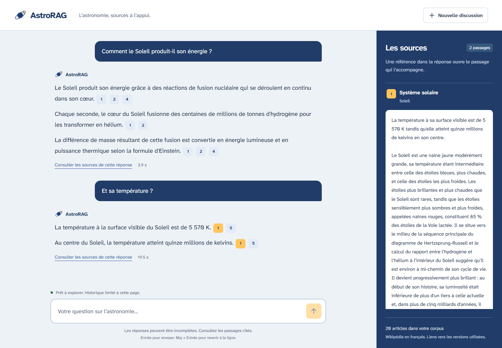

# AstroRAG

Projet personnel pour apprendre à construire un RAG sur l’astronomie.

L’objectif est de répondre à des questions en français à partir d’une petite collection d’articles Wikipédia, en affichant les sources et les passages utilisés.

## Fonctionnalités

- Une collection de 20 à 30 articles sur l’astronomie.
- Une recherche des passages pertinents pour une question.
- Des réponses accompagnées de sources consultables.
- Un signalement lorsque les documents ne permettent pas de répondre.
- Une interface simple pour poser des questions.

La collecte, le découpage, les embeddings, la recherche et la génération de réponses avec Gemini sont implémentés. L’interface locale permet de discuter et d’ouvrir les passages cités.

## Ouvrir l’interface

Dans le dossier du projet, après avoir préparé le corpus, l’index et la clé Gemini avec les étapes ci-dessous :

```powershell
.\.venv\Scripts\python.exe -m pip install -r requirements.txt
.\.venv\Scripts\python.exe app.py
```

Ouvrir [http://127.0.0.1:8000](http://127.0.0.1:8000). Attendre le message « Prêt à explorer », puis poser une question. Le modèle d’embeddings et l’index sont chargés une fois au démarrage du serveur et réutilisés pour les questions suivantes. Pour arrêter l’application, utiliser `Ctrl+C` dans le terminal. Si le port est déjà occupé : `python app.py --port 8001` avec le Python de l’environnement.



Une référence numérotée ouvre son passage dans le panneau des sources. Sur téléphone, les sources sont sous la discussion, avec un bouton pour revenir à la réponse. « Nouvelle discussion » efface les échanges affichés, sans recharger le modèle.

L’historique reste uniquement en mémoire dans la page : il est effacé à l’actualisation ou à la fermeture, et n’est pas enregistré sur disque par l’interface. Les trois derniers échanges servent à reformuler une question de suite comme « Et sa température ? ». Ils permettent d’identifier le sujet ; les affirmations de la réponse doivent toujours provenir des passages retrouvés. Une question avec historique utilise un appel Gemini pour la reformulation, puis un autre pour la réponse. Une première question indépendante utilise un seul appel.

La clé reste côté serveur dans `.env` et n’est jamais transmise à l’interface. Le serveur écoute uniquement sur cet ordinateur. Les erreurs de quota ou de disponibilité sont affichées avec un bouton de nouvel essai, sans appel automatique supplémentaire.

Pour une nouvelle installation, suivre dans l’ordre : création de l’environnement, collecte, découpage, construction de l’index, configuration de la clé Gemini et lancement de `app.py`. Les étapes détaillées figurent dans les sections suivantes. Les données et le modèle locaux ne sont pas inclus dans Git.

## Suivi du projet

Voir [ROADMAP.md](ROADMAP.md) pour les grandes étapes et les critères de validation.

- Une seule branche `main` pour commencer.
- Un commit par changement cohérent, réalisé avec GitHub Desktop.
- Une issue par grande étape, avec une liste de tâches dans sa description.
- Un tag pour marquer chaque version terminée.
- Les petits ajustements et corrections sont décrits directement dans les commits.

## Données et sources

La liste des 20 articles Wikipédia en français est enregistrée dans [data/sources.json](data/sources.json). Chaque entrée contient un identifiant stable, le titre de la page, son URL et son thème. Les pages ont été vérifiées lors de la sélection le 24 octobre 2026.

La collecte utilise l’API MediaWiki pour récupérer les articles sélectionnés. Il ne s’agit pas d’explorer automatiquement les liens de Wikipédia. Le script résout les redirections et conserve la révision exacte de chaque article téléchargé.

Chaque article collecté devra conserver son titre, son URL, sa date de récupération et les informations de licence et d’attribution applicables.

Les données téléchargées, les index et les clés d’API ne sont pas suivis dans Git. Les scripts de collecte et la liste des sources permettront de reconstruire les données.

## Installer et lancer la collecte

Prérequis : Python 3.10 ou plus récent et une connexion Internet. Aucune clé d’API n’est nécessaire pour cette collecte.

Ouvrir PowerShell dans le dossier du projet, puis créer un environnement Python et installer les deux bibliothèques :

```powershell
py -m venv .venv
.\.venv\Scripts\python.exe -m pip install -r requirements.txt
```

Faire un premier essai sur un article, puis récupérer tout le corpus :

```powershell
.\.venv\Scripts\python.exe scripts/collect_wikipedia.py --limit 1
.\.venv\Scripts\python.exe scripts/collect_wikipedia.py
```

Le script suit la liste de `data/sources.json` et crée :

- `data/raw/<id>.json` : le HTML reçu de l’API et les métadonnées de l’article.
- `data/processed/<id>.json` : le texte nettoyé et les mêmes métadonnées, dont la révision, la licence et le lien vers l’historique des contributeurs.
- `data/collection_report.json` : le bilan du dernier lancement, avec les succès et les erreurs.

Les textes nettoyés conservent les paragraphes, les titres et les listes. Les tableaux, les illustrations, les renvois de notes et les sections de références sont exclus de cette première version. Le HTML d’origine reste disponible localement pour améliorer le nettoyage plus tard. Les informations de licence proviennent des paramètres du site Wikipédia ; les mentions particulières d’un article restent à consulter sur sa page.

Les articles déjà téléchargés sont réutilisés depuis `data/raw/`, puis nettoyés à nouveau. On peut donc interrompre et relancer le script. Si un article échoue, la collecte continue sur les suivants et se termine avec un code d’erreur. Consulter le rapport avant d’utiliser les résultats : d’anciens fichiers peuvent encore exister après un lancement en échec ou une modification de la sélection.

Pour télécharger les versions actuelles au lieu de réutiliser le cache :

```powershell
.\.venv\Scripts\python.exe scripts/collect_wikipedia.py --refresh
```

Une collecte fraîche peut récupérer des révisions différentes. Les identifiants enregistrés dans les fichiers locaux permettent de retrouver les versions utilisées ; le dépôt ne contient pas encore de liste verrouillée de ces révisions.

Les requêtes sont séquentielles, identifiées par le nom du projet, espacées d’au moins une seconde et réessayées en cas de problème temporaire, avec trois essais au maximum.

## Découper les articles en passages

Après la collecte, lancer :

```powershell
.\.venv\Scripts\python.exe scripts/chunk_documents.py
```

Cette étape fonctionne hors ligne, sans nouvelle bibliothèque. Elle lit uniquement les articles de la sélection actuelle. Si un article manque ou ne correspond plus à la sélection, le script s’arrête avant de remplacer les résultats. Les résultats d’un lancement précédent restent alors présents : il faut corriger l’erreur et relancer avant de les utiliser.

Les passages suivent les sections et sous-sections de chaque article. Dans une section longue, le script regroupe les paragraphes jusqu’à 300 mots, en préférant une fin de paragraphe ou de phrase. Deux passages peuvent partager jusqu’à 40 mots de phrases entières. Le chevauchement peut être plus court ou nul si aucune phrase entière ne tient dans cette limite ; il ne franchit jamais une limite de section.

Une section courte reste courte afin de ne pas mélanger deux sujets. Une phrase dépassant la limite doit être coupée entre deux mots : ces cas sont comptés dans le rapport. La détection des phrases utilise des règles simples avec quelques abréviations françaises ; elle ne constitue pas une analyse linguistique complète.

Le script crée dans `data/chunks/` :

- `chunks.json` : tous les passages avec leurs métadonnées.
- `report.json` : le nombre de passages, leurs tailles et les paramètres utilisés.
- `preview.md` : dix exemples répartis sur le corpus, à relire pour évaluer le découpage.

Chaque passage contient son texte (`text`), le chemin de ses titres (`section_path`), la source, la révision, la licence et l’attribution. Ses positions `char_start` et `char_end` permettent de retrouver exactement le texte dans l’article nettoyé : `article["text"][char_start:char_end]`. Son identifiant est reproductible pour les mêmes données et paramètres. Le champ `contextualized_text` ajoute le titre de l’article et celui de la section au texte : c’est le contenu prévu pour la recherche et les réponses.

Pour essayer d’autres paramètres :

```powershell
.\.venv\Scripts\python.exe scripts/chunk_documents.py --chunk-size 250 --overlap 30
```

La limite porte sur les mots du passage, hors titres. Elle ne garantit pas une limite en tokens : il faudra vérifier celle du modèle d’embeddings choisi. Les fichiers générés restent locaux et sont ignorés par Git.

## Calculer les embeddings et rechercher

Mettre à jour les bibliothèques de l’environnement existant :

```powershell
.\.venv\Scripts\python.exe -m pip install -r requirements.txt
```

Construire l’index :

```powershell
.\.venv\Scripts\python.exe scripts/semantic_search.py build
```

Le premier lancement télécharge le modèle public [intfloat/multilingual-e5-small](https://huggingface.co/intfloat/multilingual-e5-small). Aucune clé d’API n’est nécessaire. Les fichiers du modèle restent dans `.cache/models/`, hors du suivi Git. Le calcul utilise le processeur de l’ordinateur.

Chaque passage est présenté au modèle avec les titres de l’article et de la section, précédés de `passage: `. Les questions sont précédées de `query: `, comme le demande ce modèle. Le modèle produit des vecteurs de 384 coordonnées. Le script les normalise pour que chacun ait une norme de 1.

Le modèle accepte au plus 512 tokens. Le script compte les tokens, titres et préfixe compris, et redécoupe les passages trop longs avant le calcul. Ce second découpage conserve les références et les positions dans l’article nettoyé. Il ne rajoute pas de chevauchement à l’intérieur d’un passage redécoupé. Le nombre d’entrées dans l’index peut donc dépasser le nombre de passages initiaux. Le texte n’est pas tronqué silencieusement.

L’index local `data/index/embeddings.npz` réunit la matrice des vecteurs, les passages correspondants et les paramètres du modèle. La version du modèle utilisée est enregistrée et réutilisée pour encoder les questions. Pour ce petit corpus, une matrice NumPy suffit à effectuer une recherche exacte ; une base vectorielle séparée n’est pas nécessaire à ce stade.

Poser une question et afficher les trois premiers résultats :

```powershell
.\.venv\Scripts\python.exe scripts/semantic_search.py search "Comment le Soleil produit-il son énergie ?" --top-k 3
```

La recherche fonctionne hors ligne après la construction de l’index. Elle calcule le vecteur de la question avec le même modèle, puis les scores par `scores = embeddings @ query_vector`. Comme les vecteurs ont une norme de 1, ces produits scalaires sont des similarités cosinus. Les passages sont classés du score le plus élevé au plus faible. Le terminal affiche le texte, la section et la source exacte de chaque résultat.

Les scores ne sont pas des probabilités de réponse correcte. La recherche renvoie les meilleurs résultats disponibles, même si aucun ne répond à la question. Cette étape ne génère pas encore de réponse rédigée.

Après un changement des sources, des textes ou du découpage, il faut refaire le découpage si nécessaire, puis reconstruire l’index. La recherche détecte ces changements et refuse d’utiliser un index devenu ancien.

## Contrôler la recherche

Les dix questions de départ sont dans `data/evaluation_questions.json`. Elles précisent les articles attendus et quelques mots-clés à vérifier. Pour les exécuter :

```powershell
.\.venv\Scripts\python.exe scripts/semantic_search.py evaluate --top-k 5
```

Le bilan est enregistré dans `data/index/evaluation.json`. Le contrôle automatique vérifie seulement qu’un des cinq premiers passages vient d’un article attendu et contient un terme pertinent. Il faut aussi relire les passages pour vérifier qu’ils répondent réellement aux questions : un score de réussite sur ce contrôle n’est pas une mesure complète de qualité du RAG.

Vérification initiale du 24 octobre 2026 : les 1 109 passages donnent 1 174 entrées adaptées à la limite de 512 tokens, avec des vecteurs de dimension 384. Les dix questions passent le contrôle indicatif dans les cinq premiers résultats. La relecture retrouve notamment l’explication des transits d’exoplanètes au rang 2 et des informations expliquant l’intérêt de l’infrarouge pour James Webb aux rangs 3 et 4. Le premier résultat n’est donc pas toujours le plus utile. La recherche sur l’énergie du Soleil retrouve dès le rang 1 un passage sur la fusion de l’hydrogène en hélium.

## Répondre avec Gemini 3.5 Flash-Lite

Le script `scripts/answer_question.py` utilise la recherche locale, puis transmet la question et les passages retenus à `gemini-3.5-flash-lite`. Le modèle de génération est distinct du modèle local qui calcule les embeddings. L’index existant est réutilisé.

Mettre à jour les bibliothèques :

```powershell
.\.venv\Scripts\python.exe -m pip install -r requirements.txt
```

Créer une clé depuis [Google AI Studio](https://aistudio.google.com/apikey). Préparer le fichier privé s’il n’existe pas encore :

```powershell
if (-not (Test-Path .env)) { Copy-Item .env.example .env }
```

Ouvrir `.env` dans un éditeur et renseigner la clé sur cette ligne :

```dotenv
GEMINI_API_KEY=votre_cle_ici
```

Le fichier `.env` est ignoré par Git. `.env.example`, qui ne contient aucune clé, sert de modèle. Une variable `GEMINI_API_KEY` déjà définie dans la session a priorité sur `.env`. Ne pas envoyer la clé dans un chat ou un commit.

Le niveau de facturation et les quotas sont ceux du projet Google choisi dans AI Studio. Pour démarrer avec l’offre gratuite, utiliser un projet au niveau Free Tier. Le script n’active pas la facturation et ne fait pas de nouvel essai automatique après un échec.

Poser une question :

```powershell
.\.venv\Scripts\python.exe scripts/answer_question.py "Comment le Soleil produit-il son énergie ?"
```

Le programme retrouve cinq passages par défaut et demande une réponse courte en français. Chaque affirmation est accompagnée de références comme `[1]`, dont les liens vers les révisions Wikipédia sont construits à partir des passages effectivement transmis. Les références inexistantes ou les réponses interrompues sont refusées. Si le modèle juge les passages insuffisants, le programme affiche un message d’abstention.

Ces contrôles vérifient la présence des références et leur origine ; ils ne prouvent pas que chaque affirmation est soutenue par son passage. Une relecture reste nécessaire. Aucun outil de recherche web de Gemini n’est activé : les données utilisées viennent de notre corpus.

Pour examiner les passages envoyés et vérifier les citations :

```powershell
.\.venv\Scripts\python.exe scripts/answer_question.py "Comment détecte-t-on une exoplanète par transit ?" --show-passages
```

Le dernier résultat réussi, les passages et les compteurs de tokens sont conservés localement dans `data/generation/last_answer.json`. Ces fichiers sont ignorés par Git et ne contiennent pas la clé d’API. En cas d’échec, le résultat précédent reste présent.

Pour préparer une requête sans appeler Gemini et sans clé :

```powershell
.\.venv\Scripts\python.exe scripts/answer_question.py "Comment le Soleil produit-il son énergie ?" --dry-run
```

La prévisualisation est enregistrée dans `data/generation/request_preview.json`. Elle permet de voir la question, les instructions et les passages transmis. Le nombre de passages peut être réglé avec `--top-k` entre 1 et 10. Le raisonnement est réglé sur `MINIMAL` et la sortie est limitée à 1 200 tokens, réflexion comprise. Une réponse atteignant cette limite est refusée plutôt qu’affichée partiellement.

## Vérifier les réponses générées

Trois questions sont définies dans `data/answer_evaluation_questions.json` : énergie solaire, transits d’exoplanètes et température future précise de Mars, absente du corpus.

```powershell
.\.venv\Scripts\python.exe scripts/answer_question.py --evaluate
```

Cette commande effectue trois appels Gemini, espacés de dix secondes, et enregistre `data/generation/evaluation.json`. Le contrôle automatique vérifie le format, les références et le statut d’abstention attendu. Les critères de relecture de chaque question sont inclus dans le fichier de questions. Il faut ensuite vérifier manuellement les affirmations et leurs sources.

Vérification initiale du 24 octobre 2026 : les trois questions ont donné le statut attendu. La relecture des réponses et des sources confirme la fusion de l’hydrogène dans le Soleil, l’explication du transit par une diminution périodique de luminosité et l’abstention pour la température précise de Mars en 2100. Cela constitue un premier contrôle sur trois exemples, pas une garantie pour toutes les questions.

L’intégration utilise l’API REST GenerateContent, documentée par Google : [clés d’API](https://ai.google.dev/gemini-api/docs/api-key), [sorties structurées](https://ai.google.dev/gemini-api/docs/generate-content/structured-output), [réglage du raisonnement](https://ai.google.dev/gemini-api/docs/generate-content/thinking).

## Vérifications hors ligne

```powershell
.\.venv\Scripts\python.exe -m unittest discover -s tests -v
```

Ces vérifications couvrent le nettoyage, les révisions, la reprise depuis le cache, le découpage, la recherche, le classement par cosinus, les références des réponses, l’abstention et les erreurs réseau. Les tests utilisent des réponses API simulées et ne consomment pas le quota Gemini.

Les tests du serveur couvrent aussi le chargement unique du modèle, la validation de l’historique et les requêtes de l’interface.

Pour vérifier l’interface dans Microsoft Edge installé sur Windows, installer les outils facultatifs et laisser le serveur lancé dans un autre terminal :

```powershell
.\.venv\Scripts\python.exe -m pip install -r requirements-dev.txt
.\.venv\Scripts\python.exe scripts/check_interface.py
```

Le contrôle navigateur utilise des réponses simulées pour les erreurs, les citations et le nouvel essai. Ajouter `--live` pour vérifier une vraie question sur le Soleil puis « Et sa température ? » : cela effectue trois appels Gemini. Les captures et le bilan restent dans `.impeccable/review/`, ignoré par Git.

Vérification du 24 octobre 2026 : 48 tests hors ligne réussis, parcours navigateur sur ordinateur et mobile, référence ouvrant le bon passage, nouvel essai sans doublon, historique effacé à l’actualisation, absence de débordement horizontal et de faute JavaScript détectée. Le parcours réel confirme la compréhension d’une question de suite et un seul chargement du modèle pour l’ensemble de la discussion.
